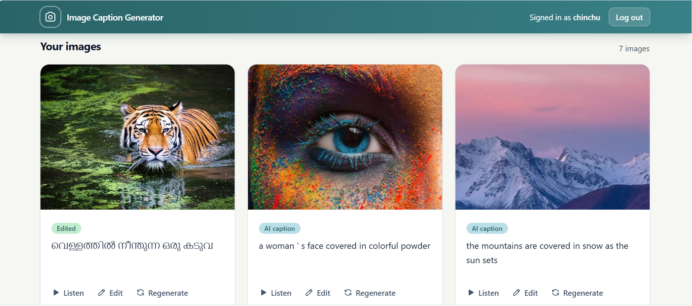
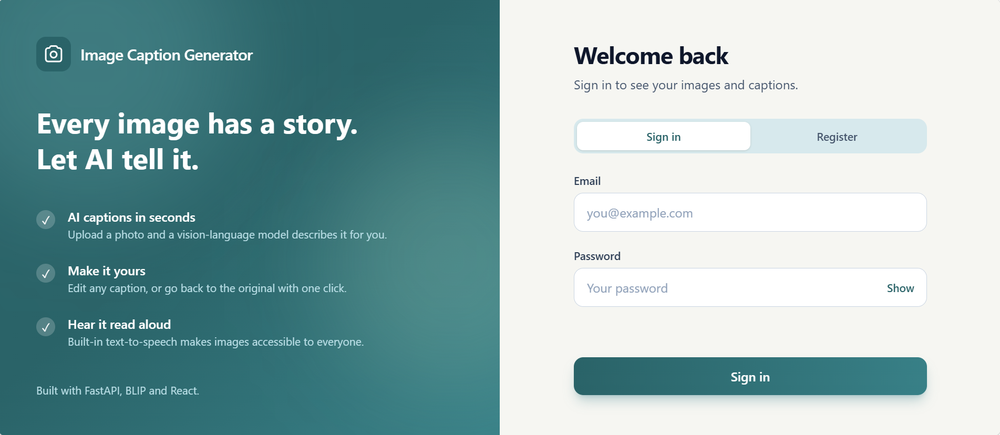
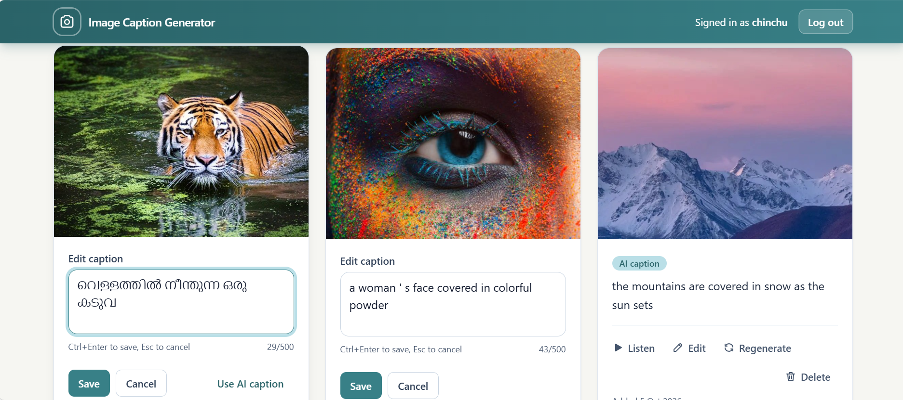
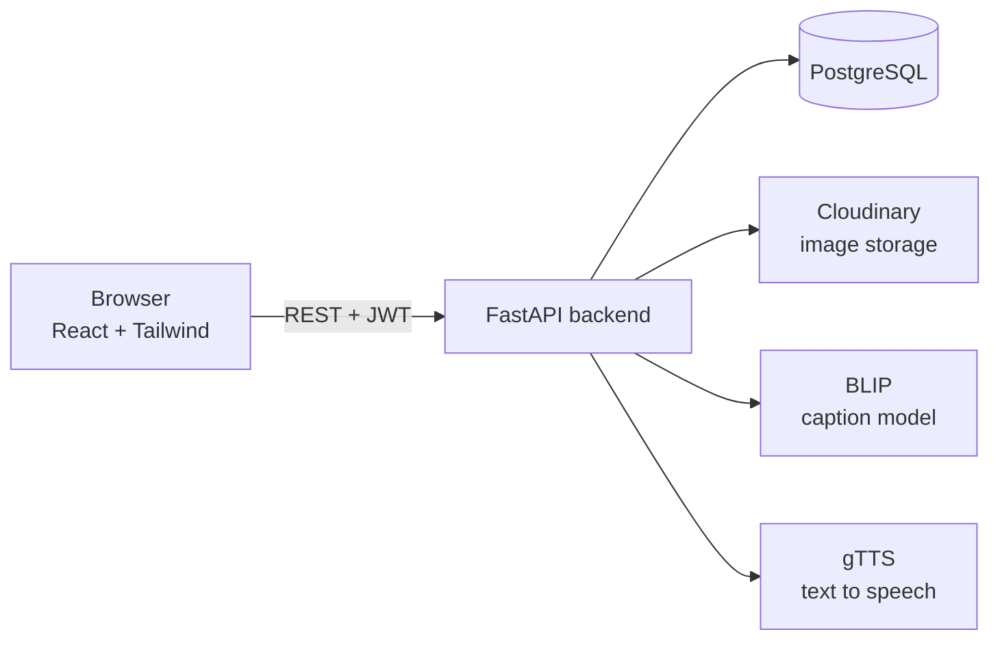

# Image Caption Generator

Upload an image, get an AI-written caption, edit it, and hear it read aloud.
A full-stack project built with **FastAPI**, **React** and the **BLIP** vision-language model, using only free and open-source tools.



## Features

- **Accounts:** register and sign in with email and password (bcrypt-hashed passwords, JWT access tokens).
- **Safe uploads:** JPEG, PNG and WebP up to 5 MB. Files are validated by actually decoding them, resized with OpenCV to at most 1024 px, and re-encoded as JPEG, which also strips metadata such as GPS location. Images are stored on Cloudinary.
- **AI captions:** generated by Salesforce's BLIP model. Regenerate any time.
- **Edit captions:** write your own version, or reset to the AI caption. Both versions are stored.
- **Listen:** text-to-speech with gTTS. Malayalam, Hindi and Tamil are chosen automatically when a caption is written in those scripts. If the server voice fails, the browser's built-in voice takes over.
- **Gallery:** your images, newest first, with "load more" paging and delete with confirmation.
- **Accessible by design:** each image's caption is its `alt` text, status messages are announced to screen readers, everything works from the keyboard, and animations respect "reduce motion".

## Screenshots

| Sign in | Gallery | Editing a caption |
|---|---|---|
|  |  |  |

## Tech stack

| Area | Tools |
|---|---|
| Backend | FastAPI, SQLAlchemy 2, Alembic, Pydantic |
| Database | PostgreSQL (run in Docker for development) |
| Machine learning | BLIP (`Salesforce/blip-image-captioning-base`) via PyTorch and Hugging Face Transformers |
| Image handling | OpenCV, Pillow, Cloudinary (free plan) |
| Text-to-speech | gTTS, Web Speech API fallback |
| Frontend | React, Vite, React Router, Tailwind CSS |

## How it works



1. You upload a photo. The backend validates it, resizes it, and stores it on Cloudinary.
2. The backend fetches the stored image and BLIP generates a caption. The model is loaded once when the server starts.
3. The caption is saved. If you edit it, your version is stored next to the AI one, and the app shows yours.
4. **Listen** requests an MP3 of the final caption from the backend. An `ETag` lets the browser reuse audio but never replay a stale one after an edit.

## Getting started

You need Python 3.12 or newer (developed on 3.14), a current Node.js (developed on 26), Docker, and a free [Cloudinary](https://cloudinary.com) account.

```bash
git clone https://github.com/<ChinnuChinchu>/image-caption-generator.git
cd image-caption-generator
```

**1. Database** (from the project root):

```bash
docker compose up -d
```

**2. Backend**

```bash
cd backend
python -m venv venv
venv\Scripts\activate            # macOS/Linux: source venv/bin/activate
pip install -r requirements.txt -r requirements-ml.txt
copy .env.example .env           # macOS/Linux: cp .env.example .env
```

Open `backend/.env` and set `SECRET_KEY` (the file shows how to generate one) and your three Cloudinary values. Then:

```bash
alembic upgrade head             # creates the tables
uvicorn app.main:app
```

The first start downloads the BLIP model (about 1 GB), so wait for `Application startup complete`. Later starts take seconds. The interactive API docs are at http://127.0.0.1:8000/docs.

**3. Frontend** (in a second terminal)

```bash
cd frontend
npm install
copy .env.example .env           # macOS/Linux: cp .env.example .env
npm run dev
```

Open http://localhost:5173, create an account and upload an image.

## Configuration

Backend settings (`backend/.env`):

| Variable | Purpose | Default |
|---|---|---|
| `DATABASE_URL` | PostgreSQL connection string | none, required |
| `SECRET_KEY` | Signs login tokens | none, required |
| `CLOUDINARY_CLOUD_NAME`, `CLOUDINARY_API_KEY`, `CLOUDINARY_API_SECRET` | Image storage | none, required |
| `CORS_ORIGINS` | Websites allowed to call the API | `http://localhost:5173,http://127.0.0.1:5173` |
| `ACCESS_TOKEN_EXPIRE_MINUTES` | Login lifetime | `60` |
| `MAX_UPLOAD_MB` | Upload size limit | `5` |
| `MAX_IMAGE_SIDE` | Longest side after resizing, in pixels | `1024` |
| `CAPTION_BACKEND` | Where captions are made (`local` runs BLIP in the app) | `local` |
| `BLIP_MODEL_NAME` | Hugging Face model id | `Salesforce/blip-image-captioning-base` |

Frontend (`frontend/.env`): `VITE_API_URL`, the backend address.

## API overview

| Method | Path | Purpose |
|---|---|---|
| POST | `/auth/register` | Create an account |
| POST | `/auth/login` | Get an access token (form fields; the email goes in `username`) |
| GET | `/auth/me` | Current user |
| POST | `/images/upload` | Upload an image |
| GET | `/images` | List your images (`skip`, `limit`) |
| GET | `/images/{id}` | One image |
| POST | `/images/{id}/caption` | Generate or regenerate the AI caption |
| PATCH | `/images/{id}/caption` | Save your caption, or `null` to reset |
| GET | `/images/{id}/audio` | MP3 of the caption (`lang` optional) |
| DELETE | `/images/{id}` | Delete an image |
| GET | `/health` | Server and database check |

Every `/images` route needs a login token and only returns your own images. Someone else's image answers 404, so IDs can't be probed.

## Project structure

```text
.
├── docker-compose.yml          PostgreSQL for development
├── backend/
│   ├── alembic/                database migrations
│   ├── requirements.txt        web app dependencies
│   ├── requirements-ml.txt     torch and transformers (only for CAPTION_BACKEND=local)
│   └── app/
│       ├── main.py             app, CORS, startup
│       ├── core/               settings and security (hashing, tokens)
│       ├── db/                 engine and sessions
│       ├── models/             User, Image
│       ├── schemas/            request and response shapes
│       ├── api/                auth and image routes
│       └── services/           image processing, storage, captioning, text-to-speech
└── frontend/
    └── src/
        ├── api.js              all calls to the backend
        ├── audio.js            playback with browser-voice fallback
        ├── context/            login state, toast messages
        ├── components/         navbar, upload zone, image card, ...
        └── pages/              sign in / register, dashboard
```

## Limitations and next steps

- **Caption quality:** BLIP base writes short, generic captions and does best on real photographs. Illustrations and posters can give odd results (repetition is reduced but not eliminated). A larger model, or a model prompted for longer descriptions, would help.
- **Not deployed:** the website, API and database fit on free hosting tiers, but BLIP needs about 1 to 2 GB of RAM, more than free web servers offer. Captioning goes through one small interface (`services/captioning.py`), so a hosted-model implementation can be added without touching the rest of the app.
- **No automated test suite yet.**
- Login tokens are kept in `localStorage` and there are no refresh tokens or rate limits. This is fine for a portfolio project but would need hardening for real use.

## Credits and licenses

Captions come from [BLIP](https://huggingface.co/Salesforce/blip-image-captioning-base) by Salesforce (see its model card for the license). Speech uses [gTTS](https://github.com/pndurette/gTTS). The project's own code is under the MIT License.